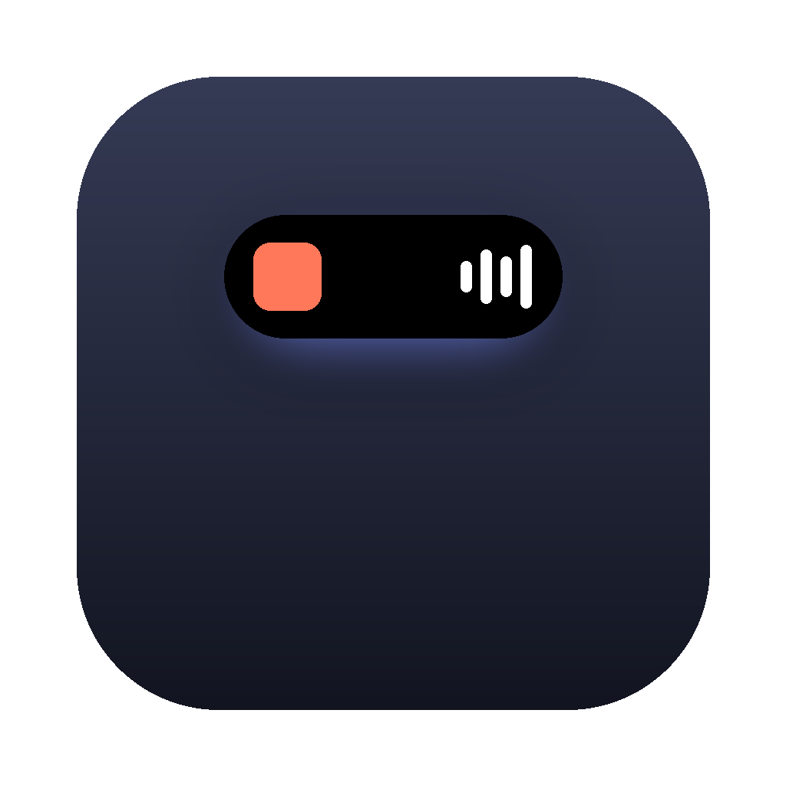

<p align="center">
  
</p>

<h1 align="center">NotchIsland</h1>

<p align="center">
  A Dynamic Island for the MacBook camera notch. Native Swift, free and open source.
</p>

---

Hover over the notch and it expands into a panel with your music, weather, calendar, sports scores and a drop zone for files. While closed, it shows live activities next to the notch.

## Features

- **Expands from the notch** with a spring animation, on hover or on click.
- **Now playing** for Spotify and Apple Music: artwork, title, artist, a draggable progress bar, play/pause, next/previous, shuffle and repeat. Click the artwork to open the player.
- **Weather** for your current location or any city: current conditions, feels-like, humidity, wind and a 5-day forecast. Celsius or Fahrenheit.
- **Calendar:** your upcoming events for the week. Add an event from the notch with a title, time, duration and alert. The alert is saved on the event, so Calendar reminds you on every device.
- **Sports:** pick a league and your favorite team. See the live score, the latest result and the next games. NFL, NBA, WNBA, MLB, NHL, MLS, Premier League, La Liga, Bundesliga, Serie A, Ligue 1, Champions League and US college football and basketball.
- **Lyrics:** time-synced lyrics for whatever plays in Spotify or Music. See them scroll in the island, follow the current line under the closed notch, or show them on your desktop in one of three styles, with the desktop tinted in the album's colors.
- **Notes:** sticky notes in the notch. Write a quick note, color it, and pin important ones to the top. Saved on your Mac only.
- **Drop zone:** drag files onto the notch to park them. Then copy or move them to Desktop, Downloads, iCloud Drive, Dropbox, Google Drive, OneDrive or any folder; share them; AirDrop them; copy them to the clipboard; or drag them out.
- **Live activities while closed:** live score while your team plays, a heads-up before your next event, music artwork with animated bars, and a "Charging" pill when you plug in.
- **Customize bar:** press the sliders button in the island to show, hide and reorder widgets and change the island size, right in the notch.
- **Works without a notch:** draws a notch-shaped island on external displays and older Macs.
- **Light on resources:** no polling while idle. Updates come from system notifications; weather and scores refresh when you open the island, and scores poll once a minute only during a live game.

## Requirements

- macOS 14 Sonoma or later
- Apple silicon or Intel

## Install

1. Download the latest `NotchIsland-x.y.z.dmg` from the [Releases](../../releases) page.
2. Open it and drag **NotchIsland** to **Applications**.
3. Open NotchIsland. A capsule icon appears in the menu bar. There is no Dock icon.

> **Unsigned builds:** if a release was built without a Developer ID certificate, macOS blocks it on first launch.
> Open **System Settings → Privacy & Security**, scroll down, and click **Open Anyway**. Only do this for builds you downloaded from this repository's Releases page.

## Permissions

| Permission | When it is asked | Why |
|---|---|---|
| Automation: Spotify / Music | First time a player is running | Read artwork, position, shuffle and repeat; send playback commands |
| Location | First time the Weather widget loads with "Use my current location" on | Local weather. You can pick a city instead. |
| Calendars | When you press "Allow Calendar Access" | Show events and add new ones |
| Files in Desktop, Documents or Downloads | First time you copy into one of those folders | Copy or move files from the drop zone |

Hover detection uses mouse-move events, which do not require Accessibility access.

## Privacy

NotchIsland has no analytics and no accounts. It makes these network requests and no others:

| Service | Sent | Why |
|---|---|---|
| `api.open-meteo.com`, `geocoding-api.open-meteo.com` | Coordinates rounded to about 10 m, or the city name you search for | Weather and city search |
| `site.api.espn.com` and ESPN image servers | League and team ID | Scores, schedules and team logos |
| `i.scdn.co` | Nothing beyond the image request | Spotify artwork |
| `lrclib.net` | Song title, artist, album and length | Lyrics |

Your location never leaves your Mac except as weather coordinates. Calendar data and notes stay on your Mac. Notes are saved in `~/Library/Application Support/NotchIsland/notes.json`. Drop zone items are stored as file paths in the app's preferences and are only copied where you tell them to go.

## Build from source

You need Xcode 16 or later.

```bash
git clone <this-repo-url>
cd NotchIsland
./scripts/run-app.sh
```

`run-app.sh` builds `NotchIsland.app` for your Mac and opens it. Use it to test everything.

For quick UI work you can use `swift run`, or open `Package.swift` in Xcode and press **Run**. Without the app bundle, macOS cannot ask for location or calendar access, so those features show a notice instead.

Run the tests:

```bash
swift test
```

Build a distributable `.app`, `.zip` and `.dmg` into `build/`:

```bash
./scripts/build-app.sh
```

The default build is ad-hoc signed. See [docs/RELEASING.md](docs/RELEASING.md) for Developer ID signing and notarization.

> **Note:** location, calendar and "Launch at login" only work from the built `NotchIsland.app`, not from `swift run`.

## How it works

| Piece | File |
|---|---|
| Entry point; accessory app with no Dock icon | `App/NotchIslandMain.swift` |
| Menu bar item, screen changes, settings window | `App/AppDelegate.swift`, `App/SettingsWindowController.swift` |
| Notch detection from `NSScreen.safeAreaInsets` and `auxiliaryTopLeftArea`/`auxiliaryTopRightArea` | `Core/NotchGeometry.swift` |
| Borderless, transparent `NSPanel` above the menu bar on every Space | `Core/NotchPanel.swift` |
| Global mouse monitors, open/close timing, click-through while closed | `Core/NotchController.swift` |
| Shared state, live-activity priority | `Core/NotchViewModel.swift` |
| Preferences, widget order, island sizes | `Core/AppSettings.swift` |
| Now playing from Spotify/Music distributed notifications plus AppleScript | `Services/NowPlayingService.swift` |
| Weather from Open-Meteo, location from CoreLocation | `Services/WeatherService.swift` |
| Scores and schedules from ESPN's public API | `Services/SportsService.swift` |
| Events, new events and heads-up timing with EventKit | `Services/CalendarService.swift` |
| Drop zone, destinations, copy and move | `Services/ShelfStore.swift` |
| Sticky notes, saved as JSON | `Services/NotesStore.swift` |
| Lyrics from LRCLIB, LRC parsing, current line | `Services/LyricsService.swift` |
| Album colors for tinted backgrounds | `Services/ArtworkPalette.swift` |
| Desktop lyrics window | `Core/DesktopLyricsController.swift`, `Views/DesktopLyricsView.swift` |
| Battery from IOKit power-source notifications | `Services/BatteryService.swift` |
| Animated notch outline | `Views/NotchShape.swift` |
| Customize bar | `Views/CustomizeBar.swift` |
| Widget and settings views | `Views/` |

### Why not MediaRemote?

Most notch apps used the private `MediaRemote` framework to read now-playing info from any app. Since macOS 15.4, Apple blocks it for third-party apps. NotchIsland supports Spotify and Music through their public notifications and AppleScript dictionaries instead. Support for other players is a welcome contribution.

### About the sports data

ESPN's site API is public but undocumented. It needs no key, but ESPN can change it without notice. All parsing lives in `ESPN` in `SportsService.swift`, so a fix stays in one place.

## Roadmap

- [ ] More players (browsers, VLC, IINA)
- [ ] Reminders app (EKReminder) list
- [ ] Several favorite teams
- [ ] Direct Dropbox and Google Drive upload without their desktop apps
- [ ] Volume and brightness HUD replacement
- [ ] Per-display islands on multi-monitor setups
- [ ] Sparkle auto-updates
- [ ] Localization

## Contributing

Pull requests are welcome. Read [CONTRIBUTING.md](CONTRIBUTING.md) first.

## License

[MIT](LICENSE)
